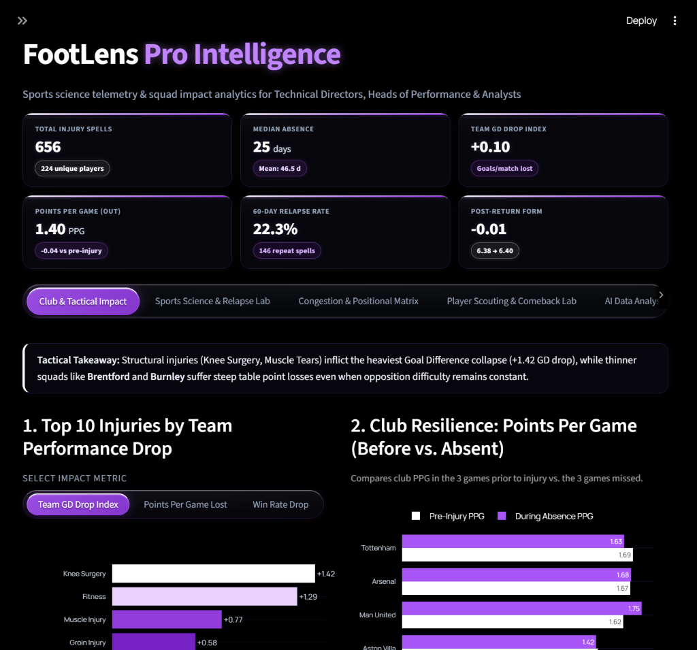
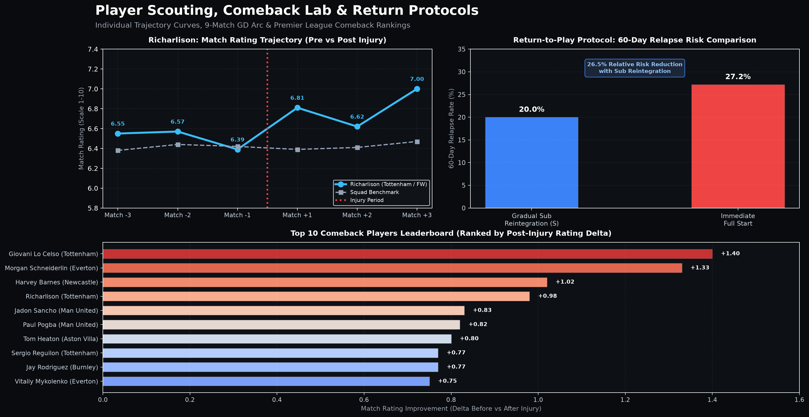

# FootLens Analytics: Player Injuries & Team Performance Dashboard

**Course:** Mathematics for AI-II (CRS: Artificial Intelligence)  
**Assessment:** Summative Assessment — Developing User-Centered Dashboards to Solve Real-World Problems  
**Student Name:** Saurav Kamble  
**Candidate Registration Number:** 1000323  
**School:** Ryan Global School  

---

## Live Deployment & Preview
- **Live Streamlit Cloud App:** `[Paste your deployed Streamlit Cloud URL here]`
- **GitHub Repository:** `https://github.com/monkey8D8luffy/IADAI102(1000323)-SauravKamble`

*(Add 2–3 screenshots of your running dashboard in an `assets/` folder and embed them below:)*




---

## How to Run Locally
```bash
# 1. Install dependencies
pip install -r requirements.txt

# 2. Launch Streamlit application
streamlit run app.py
```
